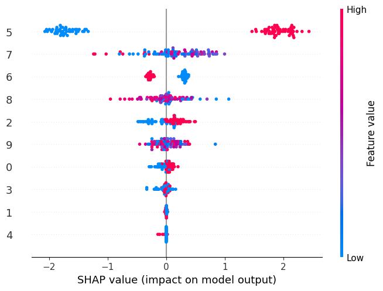
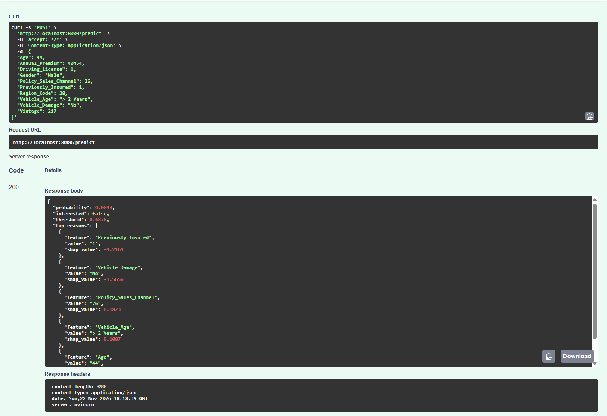

# Explainable Insurance Cross-Sell Prediction

**From a Databricks research notebook to a live, explainable prediction API.**
Predicts which health-insurance customers will buy vehicle insurance, and explains every single prediction, so marketing teams and auditors can see *why* a customer was targeted.

[](https://github.com/JunayedMiah/Insurance-Cross-sell-Prediction/actions/workflows/ci.yml)


### 🔗 Live demo: [insurance-cross-sell-prediction.onrender.com/docs](https://insurance-cross-sell-prediction.onrender.com/docs)
<sub>Free hosting: the first request after a quiet period can take 30–60 seconds while the server wakes up.</sub>

---

## Table of contents

1. [Business problem](#business-problem)
2. [What I built](#what-i-built)
3. [Results](#results)
4. [Key findings](#key-findings)
5. [Explainability](#explainability)
6. [Using the API](#using-the-api)
7. [Engineering decisions](#engineering-decisions)
8. [Run it yourself](#run-it-yourself)
9. [Project structure](#project-structure)
10. [Limitations and next steps](#limitations-and-next-steps)

---

## Business problem

Cross-selling to existing customers is one of the cheapest ways for an insurer to grow, but only if the offer reaches the right people. Calling every customer wastes money; calling the wrong ones annoys them.

Only **12% of customers** in the data are interested in vehicle insurance. The model has to find that small group, and in a regulated industry it also has to explain each decision. A black-box score is not enough.

**Data:** [Kaggle Health Insurance Cross Sell Prediction](https://www.kaggle.com/datasets/anmolkumar/health-insurance-cross-sell-prediction), 381,109 customers, 10 features (age, gender, region, vehicle age, previous vehicle damage, existing insurance, premium, sales channel, customer tenure).

---

## What I built

The project has two phases. The first answers *"can we predict this, and why?"*; the second turns the answer into a service that others can actually call.

```mermaid
flowchart LR
    subgraph P1["Phase 1 · Research (Databricks)"]
        A[Raw CSV] --> B[Spark ingestion<br/>and EDA]
        B --> C[Spark ML pipeline<br/>encoding, scaling]
        C --> D[3 baseline models]
        D --> E[Optuna tuning<br/>50 trials]
        E --> F[MLflow tracking<br/>Unity Catalog registry]
        F --> G[SHAP and LIME<br/>analysis]
    end
    subgraph P2["Phase 2 · Production (this repo)"]
        H[train.py<br/>train / val / test split] --> I[model.joblib<br/>+ tuned threshold]
        I --> J[FastAPI service<br/>SHAP per request]
        J --> K[Docker image]
        K --> L[CI on GitHub Actions]
        L --> M[Live on Render]
    end
    G -. lessons learned .-> H
```



### Phase 1: Research on Databricks ([`notebooks/insurance.ipynb`](notebooks/insurance.ipynb))

1. **Ingestion and EDA:** loaded the data with Spark and analysed each feature against the target with Matplotlib and Seaborn.
2. **Feature pipeline:** built a Spark ML pipeline (StringIndexer, OneHotEncoder, VectorAssembler, StandardScaler).
3. **Baselines:** compared Logistic Regression, Random Forest and XGBoost on precision, recall, F1 and ROC AUC rather than accuracy, which is misleading on imbalanced data.
4. **Tuning:** optimised XGBoost with Optuna (50 trials over depth, learning rate, sampling and regularisation).
5. **Tracking and governance:** logged parameters, metrics, the model and all plots to MLflow and registered the model in Unity Catalog.
6. **Explainability:** SHAP (global bar and beeswarm plots, local waterfall plots) and LIME as an independent, model-agnostic check.

### Phase 2: Production API (`src/insurance_api/`)

1. **Reproducible training script** with a clean train / validation / test split and a decision threshold tuned on validation data.
2. **REST API** (FastAPI) that returns a score, a decision and the top 5 reasons for every customer.
3. **Input validation** (Pydantic), batch predictions, health and model-info endpoints, request logging.
4. **13 automated tests**, linting, a multi-stage **Docker** image and a **CI pipeline** that builds the image and sends a real prediction to it on every push.
5. **Deployed** on Render with a public Swagger UI.

---

## Results

### Production model (live)

Held-out test set (57,167 customers), never used for training or threshold tuning. The live numbers are always available at [`/model-info`](https://insurance-cross-sell-prediction.onrender.com/model-info).

| Metric | Value | For comparison |
| --- | --- | --- |
| ROC AUC | **0.857** | 0.5 = random |
| PR AUC | **0.368** | 0.123 = random (the positive rate), so **3× better** |
| F1, positive class | **0.458** | 0.22 if every customer is called |

### Research phase (notebook)

| Metric | Baseline (Logistic Regression) | Tuned XGBoost |
| --- | --- | --- |
| ROC AUC | 0.824 | 0.833 |
| F1 | 0.380 | 0.424 |
| Precision | 0.237 | 0.274 |
| Recall | 0.961 | 0.896 |

**Why the production model is better:** it uses all 10 features, including `Previously_Insured`, `Region_Code` and `Policy_Sales_Channel`, which the notebook pipeline left out. `Previously_Insured` turned out to be the single strongest signal (see below). The decision threshold is also tuned for F1 instead of using the default 0.5.

---

## Key findings

- **Customers who already have vehicle insurance almost never buy.** `Previously_Insured = 1` is the strongest signal in the model and pushes the score sharply down.
- **Previous vehicle damage is the strongest reason to buy.** Customers with `Vehicle_Damage = Yes` are far more likely to be interested, both in the EDA and in the SHAP analysis.
- **Practical takeaway:** filtering out already-insured customers and prioritising those with past vehicle damage removes most of the wasted calls before any model is involved.
- **SHAP and LIME agree** on the top drivers for individual customers, which gives confidence that the model has learned real signal rather than noise.

---

## Explainability

### Global: which features matter overall (SHAP, research phase)



Each dot is one customer. Red means a high feature value, blue a low one; dots to the right push the prediction towards "interested". The notebook plots use the encoded column index:

| Index | Feature | Index | Feature |
| --- | --- | --- | --- |
| 0–1 | Gender | 7 | Age |
| 2–4 | Vehicle_Age | 8 | Annual_Premium |
| 5 | Vehicle_Damage = Yes | 9 | Vintage (tenure) |
| 6 | Vehicle_Damage = No | | |

Feature 5 (past vehicle damage) dominates: having it pushes customers strongly towards buying.

### Local: why this specific customer (production API)

The API explains every prediction with exact TreeSHAP values, grouped back into the original business features:



### SHAP vs. LIME

| Aspect | SHAP | LIME |
| :--- | :--- | :--- |
| Consistency | Same output for the same input | Can vary between runs |
| Speed | Slower on large models | Faster |
| Theory | Game theory (Shapley values) | Local surrogate model |
| Scope | Global and local | Mainly local |

SHAP was chosen for the API because consistent explanations matter in a regulated setting: the same customer must always get the same reasons.

More plots: [`images/`](images/) (SHAP bar and waterfall plots, LIME explanations).

---

## Using the API

Try it in the browser at **[/docs](https://insurance-cross-sell-prediction.onrender.com/docs)**, or from the command line:

```bash
curl -X POST https://insurance-cross-sell-prediction.onrender.com/predict \
  -H "Content-Type: application/json" \
  -d '{
    "Gender": "Male", "Age": 44, "Driving_License": 1, "Region_Code": 28,
    "Previously_Insured": 1, "Vehicle_Age": "> 2 Years", "Vehicle_Damage": "No",
    "Annual_Premium": 40454, "Policy_Sales_Channel": 26, "Vintage": 217 }'
```

Response (the API returns the top 5 reasons; 3 shown here):

```json
{
  "probability": 0.0043,
  "interested": false,
  "threshold": 0.6876,
  "top_reasons": [
    {"feature": "Previously_Insured",   "value": "1",  "shap_value": -4.2164},
    {"feature": "Vehicle_Damage",       "value": "No", "shap_value": -1.5656},
    {"feature": "Policy_Sales_Channel", "value": "26", "shap_value":  0.1823}
  ]
}
```

This customer already has vehicle insurance and no damage history, so the model says "not interested", and the reasons show exactly that. Positive SHAP values push towards "interested", negative ones away from it (log-odds scale).

| Endpoint | Purpose |
| --- | --- |
| `POST /predict` | One customer, with explanation |
| `POST /predict/batch` | Up to 1,000 customers at once |
| `GET /model-info` | Model version, threshold and test metrics |
| `GET /health` | Liveness check for monitoring |
| `GET /docs` | Interactive Swagger UI |

Invalid input (for example `"Age": 5` or an unknown category) returns **HTTP 422** with a clear error message.

---

## Engineering decisions

| Decision | Why |
| --- | --- |
| **Threshold tuned for F1 on a validation split** | With 12% positives, the default 0.5 is arbitrary. The threshold is chosen on validation data, and metrics are reported on a separate test split so they are not inflated. |
| **Exact TreeSHAP from XGBoost** (`pred_contribs=True`) | Same values as the `shap` package, but no extra dependency, a smaller image and fast enough for real-time requests. |
| **One explanation per business feature** | One-hot columns such as `Vehicle_Age_< 1 Year` are summed back into `Vehicle_Age`, so the explanation reads the way a business user thinks. |
| **Rare and unseen categories grouped** | `min_frequency` and `handle_unknown="infrequent_if_exist"`: a new region code does not crash the API. |
| **Shared preprocessing code** | Training and serving use the same `features.py`, which prevents training/serving skew. |
| **Strict input validation** | Pydantic rejects impossible values before they reach the model. |
| **Model trained during the Docker build** | The image always ships a model built with exactly the same library versions it runs with. |
| **Synthetic test data** | Tests and CI run on generated data with the Kaggle schema, so they are fast and need no downloads. |

---

## Run it yourself

```bash
git clone https://github.com/JunayedMiah/Insurance-Cross-sell-Prediction.git
cd Insurance-Cross-sell-Prediction
make install                 # dependencies
make train                   # trains on data/train.csv and prints the metrics
make serve                   # API at http://localhost:8000/docs
make test                    # 13 tests
make docker                  # build and run the container
```

On Windows without `make`, see the commands in the [`Makefile`](Makefile).

**CI:** every push runs ruff, the test suite, a Docker build and a smoke test that sends a real prediction to the running container.

**Deployment:** Render builds the Dockerfile directly from this repository, with `/health` as the health check.

---

## Project structure

```
├── notebooks/insurance.ipynb    Phase 1: EDA, baselines, Optuna, MLflow, SHAP, LIME (Databricks)
├── src/insurance_api/
│   ├── features.py              shared preprocessing for training and serving
│   ├── train.py                 training, threshold tuning, evaluation
│   ├── model.py                 loads the model, predicts, builds SHAP explanations
│   ├── schema.py                request and response models
│   └── main.py                  FastAPI application
├── tests/                       API and feature tests
├── scripts/make_sample_data.py  synthetic data for tests and CI
├── images/                      SHAP and LIME plots, API screenshot
├── data/                        Kaggle data
├── Dockerfile                   multi-stage build: train, then serve
└── .github/workflows/ci.yml     lint, test, build, smoke test
```

---

## Limitations and next steps

- **Scores are rankings, not calibrated probabilities.** Class weighting shifts all scores upwards (hence the 0.68 threshold). Next step: probability calibration (isotonic regression) so a score of 0.3 means a 30% chance.
- **Research-phase tuning used the test split.** In the notebook, Optuna was scored on the same data used for the final evaluation, which can make results look slightly better than they are. The production pipeline fixes this with a separate validation split.
- **Notebook plots use encoded column indices.** Regenerating them from the production pipeline would show real feature names.
- **Monitoring:** add data-drift checks on incoming requests and log predictions for later evaluation.

---

## Author

**Md Junayed Miah** · M.Sc. Data Science, FAU Erlangen-Nürnberg
[LinkedIn](https://www.linkedin.com/in/md-junayed-miah/) · [GitHub](https://github.com/JunayedMiah)
